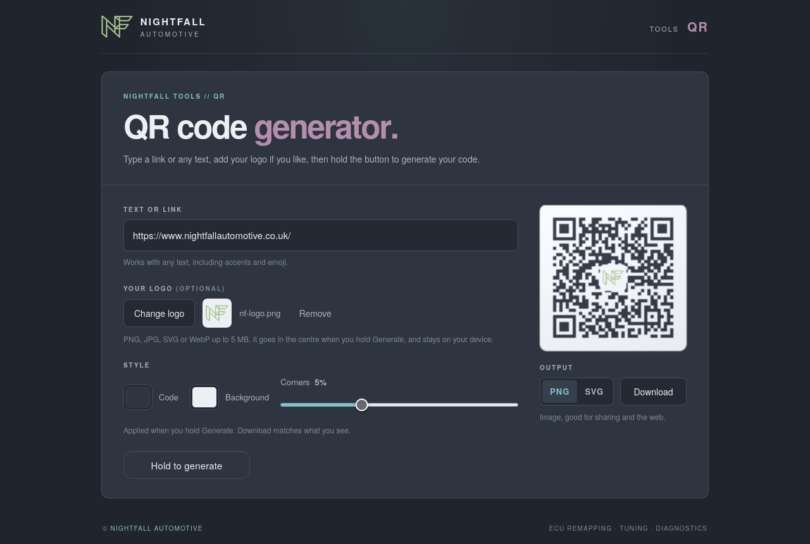
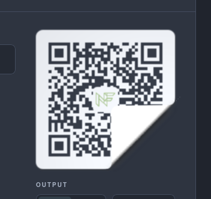
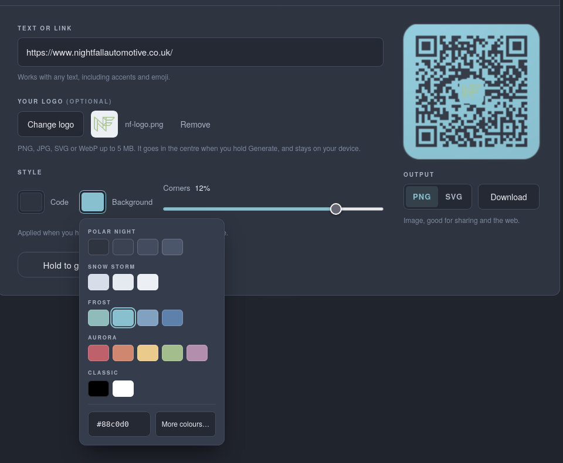
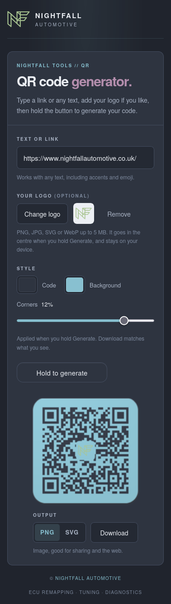

# QRCode.js
QRCode.js is a javascript library for making QR codes. It draws to an HTML5 Canvas (shown as an ``) or to SVG.
QRCode.js has no dependencies.

**Live generator: [nightfallqrcode.netlify.app](https://nightfallqrcode.netlify.app/)**: add your logo, pick colours and download as PNG or SVG.

## Screenshots

<p align="center"></p>

<table>
<tr>
<td align="center"><br>Peelable sticker preview</td>
<td align="center"><br>Nord colour picker</td>
<td align="center"><br>On a phone</td>
</tr>
</table>

## Basic Usages
```html
<div id="qrcode"></div>
<script src="qrcode.min.js"></script>
<script>
new QRCode(document.getElementById("qrcode"), "https://github.com/NightfallAutomotive/qrcodegen");
</script>
```

or with some options

```html
<div id="qrcode"></div>
<script>
var qrcode = new QRCode(document.getElementById("qrcode"), {
	text: "https://github.com/NightfallAutomotive/qrcodegen",
	width: 128,
	height: 128,
	colorDark : "#000000",
	colorLight : "#ffffff",
	correctLevel : QRCode.CorrectLevel.H, // L, M, Q or H
	useSVG: false // true draws an <svg> instead of a canvas image
});
</script>
```

and you can use some methods

```js
qrcode.clear(); // clear the code.
qrcode.makeCode("https://example.com"); // make another code.
qrcode.setLogo(imageElement); // draw a loaded  in the middle of the code.
qrcode.setLogo(null); // remove the logo.
```

A logo can also be passed up front with the `logo` option, and `logoSize` (default `0.22`) sets the size of its light backing square as a fraction of the code's width. Keep `correctLevel` at `H` when using a logo so the code still scans.

To match what scanners and print need, `quietZone` adds a light border around the code (in modules; 4 is the standard) and `cornerRadius` rounds the outer corners (as a fraction of the full width, kept inside the quiet zone so it never cuts into the code; it has no effect without a quiet zone). Outside the rounded corners the image is transparent.

`qrcode.setOptions({ colorDark, colorLight, logo, cornerRadius })` changes options for the next `makeCode()` call.

Text is encoded as UTF-8, so any Unicode text (including emoji) works. Text longer than a version 40 code can hold throws `Error("Too long data")`.

## Using with a bundler
`qrcode.js` also works as a CommonJS or AMD module:

```js
var QRCode = require("./qrcode.js");
```

## Development
```sh
npm install
npm run build # regenerate qrcode.min.js from qrcode.js
npm test      # encode, decode with jsQR and compare, for both files
```

Run `npm run build` after every change to `qrcode.js` so the minified file stays in sync.

## Browser Compatibility
All current browsers (Chrome, Edge, Firefox, Safari, and their mobile versions). Internet Explorer is no longer supported.

## License
MIT License

## Credits
Originally written by Sangmin Shim ([davidshimjs/qrcodejs](https://github.com/davidshimjs/qrcodejs)), based on [QRCode for JavaScript](https://github.com/kazuhikoarase/qrcode-generator) by Kazuhiko Arase.
